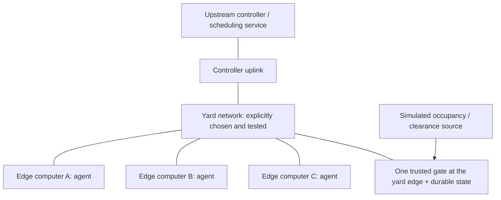

# CraneLock architecture and proposal review

Originally reviewed 3 November 2026; updated 12 November 2026. This is an evidence
review, not a deployment certificate. The original review was read-only; subsequent
merges and verification are recorded separately below.

## Latest status: 12 November 2026

Integrated platform main `02da358` into `darius`, preserving the local automatic
comparison runner and its dashboard. Arif's committed platform evidence now covers
integrated Docker services, controller/holder recovery, real network faults,
provisioned monitoring, local single-node kind persistence/reconciliation and one
external synthetic crossing. See `docs/Platform_Validation.md` and
`docs/evidence/platform/`. These are teammate-recorded runtime observations; this
Windows workstation now runs Docker Desktop; no new local Kubernetes verification
is claimed here. Nine sustained Docker workload runs completed after setup; see
[deployed results](DEPLOYED_RESULTS.md).

Added `scripts/external_workload.py` and `cranelock_sim/deployed.py` for sustained
requests against the published deployment endpoints. The runner checks public
container identity/status, keeps actor signing clients separate, validates physical
entries through the existing Lane boundary and injects only scoped container kills.
It waits for automatic LOCAL fallback before a holder-loss test and restores only
the services it stopped. Contract checks use the real signed gate with deployment
doubles; they are not Docker runtime evidence. Deployed workload execution has now passed across nine Docker runs on this
machine. Comparisons against deployed baseline algorithms remain pending.

Saved local `benefits-autonomous-validated` evidence remains unchanged and records
source `21fac92`. New local comparisons record `02da358`; deployed workload output
uses a separate directory and evaluation identity. No old timing has been upgraded
by merging code. See `docs/EVALUATION.md#test-the-integrated-containers`.

Verification: the first combined run reported 389 passed and one controller-return
convergence timeout. All three controller-process checks then passed in isolation;
that timing failure was not root-caused and should be watched during deployment
acceptance. A second combined run (including two additional external-client checks)
reported 391 passed and one recovery-CLI startup timeout. Both failed-case process
logs were empty and neither state file existed. The CLI test now requires live,
reconciled agent RPCs before starting its existing 12-second recovery budget.
Majority, holder and fail-closed assertions are unchanged. The resulting CLI,
external workload, handoff and telemetry subset passed 15 tests in 19.18 seconds.
No complete post-readiness-fix suite or Docker workload run is claimed.

## Previous status: 10 November 2026

Fetched the current teammate branches and merged `origin/main` snapshot `21fac92`
into `darius`, preserving the team-controller comparison adapter and all local
review notes. The merged code passed 373 tests. After adding the independent
comparison runner and its checks, the full suite passed **378 tests in 355.59
seconds**. This is the latest full-suite verification.

Dashboard comparison evidence was regenerated as `benefits-autonomous-validated`:
54 independent-process cases covering three systems, three scenarios, three seeds
and two request counts. All healthy batches finished; all 12 CraneLock failure
cases resumed with agent-originated majority recovery. Request CSV totals, gate
audits, persisted votes and independent occupancy events were checked. Real-browser
checks passed for all scenario charts, controller-stop playback, LOCAL recovery
and mobile layout. Sixteen obsolete saved sets and four temporary experiment
folders were removed after verification. The layout and styling were preserved.

One attempted case was invalidated when the host wall clock moved backwards by
about 1.25 seconds. The gate correctly failed closed. The case was repeated without
disabling that check; no clock rollback appears in the accepted 54-case dataset.
The matrix export/compatibility subset also passed four checks after extraction.

Important progress since the 3 November checklist:

| Earlier gap | Current status and evidence |
| --- | --- |
| Agent launcher cannot enable recovery | Addressed: explicit recovery config/key options and `--enable-recovery`; validates membership, durable state and agent-only signing credentials. See `docs/AGENT_LAUNCHER.md` and `tests/test_agent_launcher.py`. |
| Agent launcher lacks a controller probe | Addressed: `--controller-address` uses the actual CraneController heartbeat RPC, with TLS options, plus an optional explicitly configured probe adapter. |
| Controller only has a monitoring CLI | Addressed for lifecycle/heartbeat: `python -m cranelock.run_controller` starts a real controller service against a configured gate, supports TLS and restores accepted central authority. The standalone protobuf service exposes Heartbeat; normal workload scheduling and the comparison Assign wrapper remain separate concerns. |
| Autonomous failover only tested with callbacks/in one process | Stronger evidence now exists: `tests/test_controller_process.py` starts independent controller, gate and crane processes, kills the controller, observes majority LOCAL recovery and token handoff, and restarts it to verify safe CENTRAL restoration and stale-permission rejection. Both controller-only and two-survivor cases pass. |
| Recovery retries and repeated failures | New retry/round handling and tests, documented in `docs/RECOVERY_RETRY.md`; additional multiple-failure and CLI-process recovery tests pass. |
| Container recovery configuration absent | A new `scripts/validate_recovery_containers.py` generates and can run five crane containers plus a gate with durable volumes. It explicitly scopes itself to a shared gate network namespace and loopback development transport. It does not include a controller service. |
| Gate TLS/monitoring setup incomplete | Added TLS provisioning, health/deployment tests, Compose TLS override, Kubernetes gate TLS patch, Prometheus config and Grafana dashboard. Their existence and passing code tests do not establish that this workstation ran Docker/Kubernetes. |

Remaining boundaries after these changes:

1. Docker and kubectl are still not on PATH here. No live Docker daemon, cluster
   or cloud deployment was verified; obtain runtime evidence from the platform member.
2. The generated container validation is five agents plus gate, with shared network
   namespace. It does not demonstrate the complete controller + agents + gate +
   occupancy-workload deployment across independent network endpoints/machines.
3. The dashboard's new `benefits-v4` path now launches separate gate, controller
   and crane processes. Agent workers perform recovery and LOCAL token handoff;
   the runner supplies demand, physical observations and process failures.
   CENTRAL assignment still uses the test-only transport around the team's core.
   Legacy `failures.py`/`comparison.py` modes remain harness-orchestrated safety
   fixtures, distinct from the autonomous comparisons. Old saved dashboard sets
   were removed after validating the fresh process-based matrix.
4. The checked Kubernetes deployment still covers the gate, now with an optional
   TLS patch; no end-to-end crane/controller Kubernetes deployment is established.
5. Actual edge-network placement, independent failure boundaries and participant
   scalability must still be demonstrated if retained as claims. The new process
   tests accurately report loopback peer transport and mutual TLS to gate/controller.

New comparison runs record controller source `21fac92` and identify automatic
agent recovery explicitly; changing code never upgrades an old saved measurement. The preserved 3 November review
below is historical: do not treat its launcher/controller missing-work entries as
the current state.

## Current-state recheck after the merge

Rechecked on 3 November 2026 after fetching all remote updates. Local `darius`
is now `026f8ea`, merged with main `6417ecc`, and was clean and synchronized with
`origin/darius` before this documentation update. The earlier branch descriptions
below are the original review snapshot, not the current merge status.

The merged revision passed **235 tests** when the merge was completed. No source
changes or newer remote main commit were found in this recheck, so that suite was
not repeated. The team-controller adapter now records source `6417ecc` for new
runs. The existing 54-run `benefits-team-controller-validated` set still records
`0d4866b`; those are older harness-driven measurements and have not been relabeled.

### Remaining integration work and ownership

| Priority / owner | Current evidence | Required addition | Acceptance demonstration |
| --- | --- | --- | --- |
| 1. Platform + whole team: topology | Explicit peer endpoints exist; no physical edge placement or independent failure domains demonstrated | State where controller, gate, agents and occupancy simulator run, what network joins them, and what survives each fault | Show endpoints and the surviving peer/gate path after controller failure; label all simulated hardware |
| 1. Agent/recovery member: launch configuration | `Agent.start()` can run recovery workers when gate and recovery config/key are supplied; CENTRAL fallback also needs `controller_probe` | Wire those inputs into the standalone agent launch path. The current `cranelock/__main__.py` passes `gate` but not recovery config/key or a controller probe | Launch agents using supported commands; stop the controller/holder; observe agent-originated votes and gate installation without a harness recovery call |
| 1. Controller member: runnable authority service | `CentralController` and the comparison gRPC wrapper exist; controller module CLI is a state monitor | Supply a supported independently runnable controller heartbeat/assignment service, or promote the existing wrapper with explicit ownership and configuration | Stop only that service, retain agents/network/gate, then demonstrate controlled return and reconciliation |
| 1. Platform + gate member: end-to-end deployment | `compose.agents.yaml` starts LOCAL crane-a/b/c without gate options; `compose.yaml` starts the gate separately | Add one integrated launch configuration with matching membership IDs, peer names, gate config, per-agent keys, volumes and startup provisioning. Gate CLI requires mutual TLS for non-loopback addresses, so simply adding `--gate-address gate:50051` is insufficient | Fresh setup and restart using documented commands; all components communicate and persistent state is retained |
| 1. Simulator + gate member: independent occupancy source | Physical lane and trusted observation code exist inside the simulator | Run a bounded observation/crossing source that shares actual simulated occupancy and does not clear the lane because authority changed | Stop occupancy reports or fail a holder inside the lane; new entries remain blocked until explicit fresh clearance |
| 1. Testing/evaluation: autonomous deployed tests | `AgentCluster` disables auto transfer and recreates workers without recovery; `benefits.py` and `failures.py` explicitly call `propose_recovery` and `reconcile` | Add an experiment path that only submits demand, injects faults, models physical occupancy and observes the agents; it must not substitute its own recovery/handoff orchestration for the agent behaviour under evaluation | Generate new labeled evidence from the integrated service path; keep older adapter results separate |
| 2. Platform: Kubernetes claim | Checked branches contain only gate Deployment/Service/PVC and init Job; demo has an additional container recipe | If full Kubernetes deployment remains a claim, add crane identities/persistent vote storage, controller and simulator workloads, discovery/configuration and end-to-end instructions | Capture running workload/service status, container termination and recovery evidence; otherwise explicitly limit the Kubernetes claim to the gate template |
| 2. Controller + agent member: controller return | Reconciliation methods exist | Demonstrate the complete safe return path, including queued demand and lane state, without rolling back accepted authority | Controller returns during LOCAL operation; no duplicated permission or unexplained lost queued requests |
| 2. Testing/evaluation: proposal measurements | Three-agent comparison varies request counts; saved waiting/completion/recovery metrics exist | Measure more participants if retaining participant scalability, and define fairness/availability if retained as evaluation claims; otherwise narrow those claims | Reproducible participant/demand sweeps and clearly scoped metrics, including requests that never entered |

Every teammate remote branch was checked for deployment files. No fuller Kubernetes
deployment was found. The `demo` branch's progress recipe packages evaluation and
live-demo runners; it does not by itself establish one separately deployed service
per crane. No Docker or kubectl executable is on PATH here, so an actual runtime
deployment on another teammate's machine is **unverified**, not declared absent.

Required final handoff: one tested launch procedure, explicit topology/failure
boundaries, autonomous failure demonstrations, fresh result provenance and the
project's testing-instructions deliverable. Additional dashboard cosmetics are not
needed to close these gaps. Read the original audit below for the source references
and distinction between a simulated network and an operational port installation.

## Verdict

CraneLock is a defensible simulated distributed-coordination research prototype.
The implemented gate, token protocol, durable signed recovery votes and physical
lane model support a useful investigation of safety versus progress. The proposal
explicitly excludes real crane control and industrial safety certification.

However, the repository does not yet establish a complete cloud/edge deployment
with an independent surviving crane network. A working local comparison dashboard
does not establish that deployment. Calling the entire product final was too strong.

The largest unresolved issue is **where the agents, gate and controller run, and
which communication paths remain available during each advertised failure**.
Do not fill in those missing decisions by claiming Tuas already uses this protocol.

## What was reviewed and verified

- `project/GROUP20.docx`, including both architecture diagrams; the original
  `C:/Users/dkkan/Downloads/GROUP20.pdf`; and `project/Project_2026-27.pdf`.
- Local `darius` working tree at commit `69093a3`, including its uncommitted team
  controller integration. The generated team-controller comparison set is local
  evidence, not committed deployment evidence.
- Latest remote `main` and `kendrick`: `6417ecc`, automatic controller fallback.
- Remote `demo`: `f83ac97`, container/live/progress demonstration additions.
- Platform-file listings on all teammate remote branches, not just `darius`.
- Source, tests, Dockerfiles, Compose, Kubernetes manifests, protocol and safety docs.

In isolated temporary copies with the existing Python environment:

- Latest main: **20 tests passed** from `test_auto_recovery.py`,
  `test_controller_fallback.py`, and `test_agent_gate_process.py`.
- Demo: **8 tests passed** from `test_network_reconciliation_process.py`,
  `test_combined_progress_demo.py`, and `test_handoff_retry.py`.

These were selected checks, not a new full-suite validation of either remote branch.
Docker and kubectl were not available on PATH in this review environment. Container
and Kubernetes runtime claims were inspected, not reproduced. Platform validation
documents contain earlier team-reported container results; those are distinct from
the checks independently run here. No running cloud account/cluster was verified.

## 1. What actually communicates with what

The proposal's Figure A1 already draws peer connections between crane agents. The
implementation agrees: each agent receives a peer-ID-to-address map, constructs
its own gRPC channels, and sends peer messages without the central controller
relaying them. See latest main `cranelock/agent.py:90` and the `--peer` CLI option.

The current system has these layers:

| Layer | Actual role | What it does not establish |
| --- | --- | --- |
| IP network | Carries packets between reachable addresses | Not supplied by saying "gRPC" |
| gRPC/protobuf | Carries Heartbeat, TokenRequest, TokenTransfer and VoteRecovery calls | Not a radio, discovery algorithm or failover algorithm |
| CentralController | Signs/installs CENTRAL authority at the gate | Not the existing peer-message router |
| Token protocol | Current holder queues requests and hands off permission | Not a complete port scheduler |
| Recovery protocol | Signs and validates replacement authority for a higher epoch | Not full replicated-log consensus or proof of physical clearance |
| Trusted gate | Serializes accepted authority and entry checks | Not a physical barrier or sensor installation |
| Kubernetes | Can manage container identity, networking, persistence and restarts | Does not implement token voting or manufacture a surviving physical network |

Normal token handling is **request-driven token mutual exclusion with a FIFO queue**:
requests go to the known holder; duplicate queued identities are suppressed; the
holder transfers to its next queued requester, carrying queue information. This
is not the Raymond tree algorithm merely because Raymond is cited, not a fixed
token ring, and not Raft. Latest gate-enabled agents also update accepted gate
holder/revision and resolve uncertain handoffs against gate state. The simulation
adapter separately paces crossings and token handoffs.

Recovery uses heartbeat timeout suspicion, majority-signed certificates, durable
one-vote-per-target-epoch state, gate epoch/revision checks and rejection of stale
permissions. Latest main selects deterministic holder candidates to reduce
competing proposals. Majority voting is one mechanism here; it is not a claim of
general consensus with guaranteed progress in every partition or timing sequence.

## 2. The lecturer's node-to-node question

The software path exists in the prototype. The field-network design is unspecified.
To support the claim, the team needs to name the edge computers, their network
interfaces, address/discovery configuration and the network carrying peer traffic.

For a wired design, the proposed packet path would be:

```text
A's agent -> A's NIC -> site switch / routed IP network -> B's NIC -> B's agent
```

The controller application is not on that forwarding path. Its process can stop
while the switch and peer connections continue working. This is a proposed physical
mapping of the code's peer connections, not a verified Tuas installation.

For a private-5G design, the path would additionally involve radio access and the
5G data-plane/user-plane infrastructure. Local peer routing, breakout and access
policies would have to be configured and demonstrated. Private 5G does not mean
cranes automatically form a direct radio mesh or that connectivity survives loss
of the 5G core, power, shared switch or backhaul.

MPA describes remote management from the Tuas Port Control Centre and private 5G
support for AGVs and automated cranes. That supports the application motivation;
it does **not** establish PSA's peer topology, failover policy, use of CraneLock,
gRPC or Kubernetes. See [MPA's Port of the Future](https://www.mpa.gov.sg/maritime-singapore/port-of-the-future).

An application controller, the network equipment carrying its messages, and the
Kubernetes control plane are three different things. Specify which one fails.

## 3. Gate placement is essential to the advertised benefit

The protocol requires a reachable gate for authority installation and entry.
Recovering a token while the gate is unreachable does not allow progress.

If the upstream controller **and gate** sit beyond the same failed cloud uplink,
the claim "the yard keeps working after losing that uplink" is not demonstrated.
A controller-process outage with an otherwise functioning network is a narrower,
valid test, but it is not equivalent to losing the cloud connection.

One defensible target design is shown below. It is a recommendation, not the
current verified deployment or a description of PSA's actual infrastructure.



For this design, loss of the controller service/uplink may permit fallback only
while enough agents, their network, the gate and required clearance information
remain available. The surviving majority must be a majority of the configured
membership; seeing two nearby cranes is not sufficient in a larger membership.
Existing valid authority is not automatically revoked merely because no new
majority can be formed. Lack of quorum blocks replacement recovery.

The single trusted gate is a deliberate dependency: its outage stops new entry.
The manifest's one replica and SQLite database do not constitute replicated gate
consensus. Do not add replicas sharing/copying the same state and call that HA.

## 4. Proposal claims versus current evidence

| Proposal claim | Evidence and status | What remains before claiming completion |
| --- | --- | --- |
| Exclusive lane access, stale-permission rejection | Implemented gate checks and independently modeled occupancy; local tests exist | Retain bounded safety wording; no industrial safety claim |
| Unique token and request queue | Agent queue, handoff IDs, durable authority and gate checks exist | Demonstrate the deployed request and crossing path, not only an in-process runner |
| Majority holder recovery | Signed vote RPCs, persistent vote state, gate verification; automatic agent path in latest main passes selected tests | Wire all required settings into the actual launch path and container deployment |
| Controller-loss fallback | Harness-driven outage experiments exist; latest main also has an automatic recovery loop | Latest automatic tests inject probe outcomes; standalone CLI/Compose does not supply the controller probe and recovery configuration |
| Full controller service and scheduler | CentralController installs authority and reconciles supplied agents; CLI monitors state | Workload scheduling, Heartbeat/Assign server transport and much orchestration still live in the harness; no complete independent scheduling daemon is demonstrated |
| Controller-return reconciliation of epoch, holder, queue and lane | Gate-state reconciliation helpers and demo additions exist | Demonstrate complete queue/lane reconciliation and safe automatic LOCAL-to-CENTRAL return; a heartbeat alone must not switch authority |
| All components containerized | Gate/agent images; demo adds a progress/evaluation image | Existing agent Compose is LOCAL token passing without gate options; progress/evaluation starts nested loopback services, not one independently deployed crane per service |
| Kubernetes stable crane identities and persistent votes | Gate Deployment, Service, PVC and init Job exist | No crane StatefulSet, controller workload or end-to-end cluster launch found on inspected remote branches |
| Service discovery | Explicit peer endpoints; Compose names resolve on its network | Define stable per-agent identities and discovery in the chosen cluster/edge topology |
| Authenticated agents | Recovery votes and gate commands are signed; gate supports mutual TLS | Peer agent listeners/channels are plaintext; do not claim end-to-end authenticated/encrypted peer RPCs on an untrusted field network |
| Independent fault injection | Service stops and selected peer-RPC partitions; gate fault tests and synthetic stale/delayed-message checks exist | Demonstrate process/container/node failures and actual network faults with explicit scopes; selected RPC filtering leaves gate/management access intact |
| Larger participant-count scalability | Logical workload supports varying cranes; main RPC comparison uses three agents | Six versus eighteen requests varies demand, not participant count; run comparable multi-agent scaling before claiming distributed scalability |
| Fairness, availability and complete overhead evaluation | Waiting, p95, completions, detection/recovery and some RPC attempts recorded | Publish defined fairness/bypass and availability measures if retained as claims; holder-failure RPC overhead is unmeasured |
| Deployable real-port product | Physical lane simulation and development fixtures | Proposal itself excludes real cranes; no PLC, sensor, actuation or certified interlock integration is demonstrated |

The proposed basic-token baseline says it lacks fencing. In the current comparison,
all three models use the same trusted gate and stale-permission checks. This is a
reasonable controlled experiment isolating coordination/recovery, but cannot be
used to attribute the gate's safety uniquely to CraneLock. Describe the baseline
actually implemented, or run a separately labeled ablation under the same physical
checker if the report needs to isolate fencing's contribution.

## 5. Branches currently describe different products

| Version inspected | What it establishes |
| --- | --- |
| Local darius working tree | Team CentralController adapter, `benefits-v3`, 54 locally saved comparison runs; integration changes are uncommitted |
| Remote main `6417ecc` | New gate-enabled agent integration and automatic controller/holder recovery; comparison runner still imports ReferenceController |
| Remote demo `f83ac97` | Live/progress/demo-container and network reconciliation additions; not equivalent to latest main or the local team-controller experiments |

Latest main's automatic recovery requires a gate client, recovery config/key and,
for CENTRAL fallback, a controller probe. `cranelock/__main__.py` does not wire all
those inputs into Agent construction. The old simulator AgentCluster starts agents
without gate integration, disables automatic transfer and explicitly schedules
workers; its fault experiments call `propose_recovery` and `reconcile` themselves.
Therefore new automatic agent tests do not retroactively turn the old dashboard
measurements into measurements of autonomous deployed failover.

Source references:

- [Latest main agent and recovery workers](https://github.com/mmmmm0e/CSC3104_Cloud_Grp20/blob/6417ecc/cranelock/agent.py)
- [Latest main agent CLI](https://github.com/mmmmm0e/CSC3104_Cloud_Grp20/blob/6417ecc/cranelock/__main__.py)
- [Latest main simulator cluster](https://github.com/mmmmm0e/CSC3104_Cloud_Grp20/blob/6417ecc/cranelock_sim/agents.py)
- [Latest main comparison runner](https://github.com/mmmmm0e/CSC3104_Cloud_Grp20/blob/6417ecc/cranelock_sim/benefits.py)
- [Kubernetes gate manifest](https://github.com/mmmmm0e/CSC3104_Cloud_Grp20/blob/6417ecc/deploy/kubernetes/gate.yaml)
- [Separate-agent Compose](https://github.com/mmmmm0e/CSC3104_Cloud_Grp20/blob/6417ecc/deploy/compose.agents.yaml)
- [Demo Compose](https://github.com/mmmmm0e/CSC3104_Cloud_Grp20/blob/f83ac97/deploy/compose.progress.json)

## 6. What cloud and Kubernetes can legitimately contribute

The project brief requires a cloud-based distributed system and container and/or
Kubernetes use. It does not explicitly require buying AWS/Azure/GCP services.
Nevertheless, a Dockerfile or manifest by itself is not evidence of running
advertised functionality. Kubernetes is a packaging/orchestration mechanism here,
not the original contribution or the crane-coordination algorithm.

A defensible prototype deployment could run simulated edge agents, gate,
controller and observation simulator as independently addressable services in a
local Kubernetes cluster or VMs; label this a simulated edge deployment. Explain
which worker hosts each identity and which dependencies are shared. Several Pods
on the same laptop do not demonstrate independent physical-machine failures.

StatefulSets can provide stable identities/storage, and Services/DNS provide
discoverable endpoints; cluster network components provide the packet path.
These are separate from the CraneLock application controller. Do not load-balance
different logical crane identities behind one interchangeable endpoint or use
generic autoscaling to clone voting identities. Membership changes require a
protocol decision, not just more replicas. See the official
[Service](https://kubernetes.io/docs/concepts/services-networking/service/),
[StatefulSet](https://kubernetes.io/docs/concepts/workloads/controllers/statefulset/)
and [cluster networking](https://kubernetes.io/docs/concepts/cluster-administration/networking/)
documentation.

## 7. Evidence needed next, in priority order

1. Agree one integrated revision. Preserve all branches/work; combine the latest
   automatic agent path, teammate controller and evaluator deliberately, then test.
2. Draw the physical and service topology. Name cloud/upstream host, yard network,
   edge computers, gate location, discovery, keys and storage; explicitly label
   simulated components. State what controller failure means.
3. Provide one repeatable launch for independently addressable agent A/B/C, gate,
   controller and occupancy simulator, with each agent's durable identity and key.
   Wire autonomous recovery and the actual controller probe; no hidden harness
   calls may substitute for behaviour advertised as autonomous.
4. Demonstrate controller termination while peer RPCs and gate access remain
   available. Show actual endpoints, token traffic, recovery certificate and new
   authority, not only a graph or a boolean injected into a probe.
5. Repeat with a separate controller-uplink fault; then a holder crash, minority
   partition, gate outage and lost occupancy reports. Show exactly why progress
   continues or stops. Existing occupants must remain protected throughout.
6. Demonstrate controller return and an agent restart without erasing vote/gate
   state. Test stale/conflicting votes and changing authority during recovery;
   current durable-vote rules can deliberately stall rather than permit unsafe
   revoting, so do not promise unconditional eventual recovery.
7. Generate new provenance-labeled measurements from that path. Report censoring,
   timing variation and host/network conditions; vary participant count as well
   as demand if scalability remains in the contribution claim.

The research contribution can remain the integration and evaluation of safe
degraded coordination under stated conditions. It does not need a new radio,
invented consensus algorithm or claim to outperform an actual Tuas system.

## A defensible short explanation today

"CraneLock is a simulated crane-lane coordination prototype. Agents have explicit
peer endpoints and use gRPC for token and vote messages, while a trusted gate
enforces authority and occupancy. The controller is not their message relay. We
have local integration evidence and newer automatic recovery tests. We still need
to unify the branches and demonstrate the independently surviving edge network,
full service deployment and autonomous controller failover end to end."
